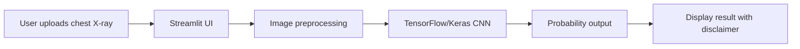
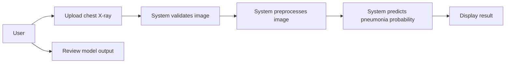
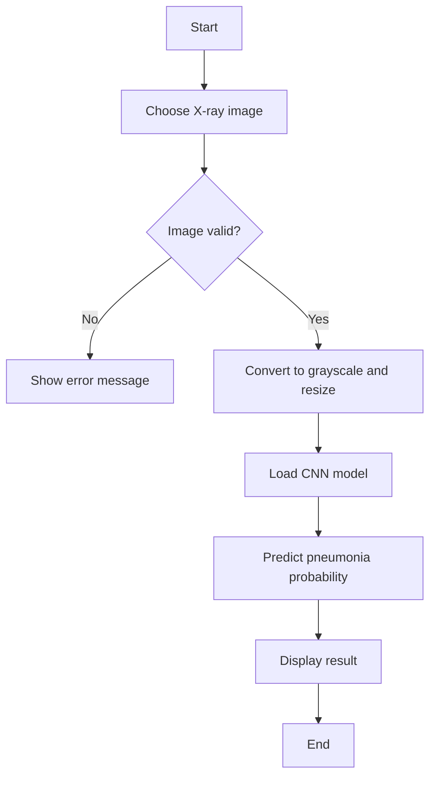
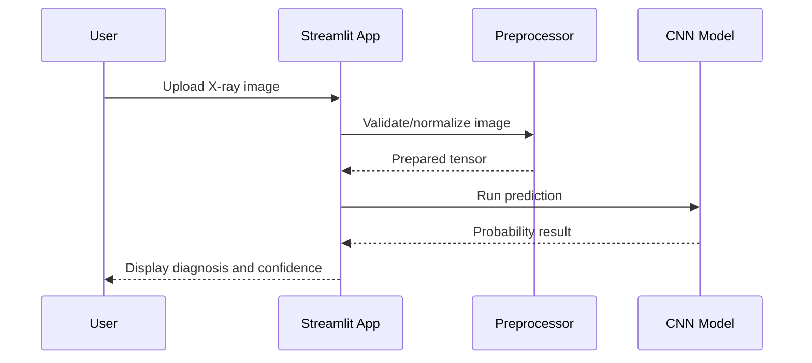
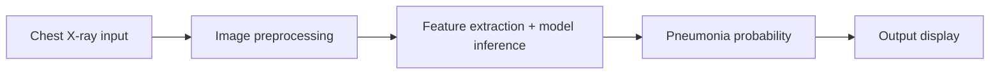

# Technical Documentation

## 1. Project Overview

This project implements a chest X-ray classification application titled **PneumoCatcher**. It allows a user to upload a chest X-ray image and obtain a pneumonia probability estimate from a trained convolutional neural network (CNN) model. The application is built using Python and Streamlit, and it currently runs locally for demonstration and educational use.

### Current implementation status

Implemented:
- Local image upload through Streamlit UI
- JPEG and PNG validation and preprocessing
- Grayscale conversion to 180x180 input size
- CNN inference using a saved Keras model
- Probability display and non-diagnostic warning message

Not implemented as a production system:
- User authentication and authorization
- Database persistence for uploads or results
- Independent evaluation dataset and formal validation report
- Deployment and security hardening

## 2. Problem Statement

Pneumonia is a life-threatening respiratory disease that requires timely diagnosis. Chest X-rays are widely used in diagnosis, but radiologist availability and time constraints can delay evaluation. A computer-assisted screening tool can help clinicians prioritize cases and support initial triage. However, any AI-based system must be used cautiously, transparently, and with appropriate validation before being trusted in medical decision-making.

## 3. Project Objectives

1. Develop a lightweight chest X-ray prediction application.
2. Use a CNN to classify X-ray images as normal or pneumonia-positive.
3. Create a simple interface that can be tested locally.
4. Prepare the project for academic documentation and review.
5. Identify risks, limitations, and future improvement areas.

## 4. Existing System

The existing system contains a single-page Streamlit app that loads a pre-trained model from `pneumonia_detection_model.keras` and runs inference on uploaded images. The project includes the following artifacts:

- `app.py`: main application frontend and inference logic
- `image_preprocessing.py`: upload validation and preprocessing helper
- `train_cnn.py`: script for continuing training with the full dataset
- `evaluate_model.py`: script for evaluation on an independent dataset
- `x_ray_full_dataset.h5`: stored dataset containing images and labels
- `pneumonia_detection_model.keras`: trained CNN model artifact

The current implementation does not include a separate backend service or database.

## 5. Proposed System

The proposed system is a local demonstration application that can detect pneumonia patterns in chest X-rays using a CNN. The system is intended for educational and research purposes, with a strongly visible disclaimer that it is not a diagnosis tool and must not replace clinical judgment.

### Functional design

- Input: a chest X-ray image in JPG or PNG
- Preprocessing: convert to grayscale, resize to 180x180, normalize pixel values
- Model: CNN with binary output probability
- Output: pneumonia probability and human-readable diagnosis

## 6. Literature Survey

This project is consistent with the general landscape of deep learning image classification for medical imaging. CNNs have demonstrated strong performance in image recognition and have been used for chest X-ray screening tasks. However, a model trained on a single dataset should be validated on an independent dataset before being treated as clinically reliable.

### Observations from this project context

- A binary classification model is appropriate for the dataset labels: 0 = Normal, 1 = Pneumonia.
- Image preprocessing is essential because the model expects 180x180 grayscale input.
- Model evaluation must be separated from training to avoid misleading accuracy metrics.
- The project is suitable for academic demonstration but should not be treated as a production medical decision support system.

## 7. Research Gap

The current project demonstrates feasibility but does not contain:
- formal clinical validation,
- patient-level train/test separation,
- reproducible training logs,
- external dataset benchmarking,
- deployment-ready security controls,
- an application backend with persistent data storage.

This makes the current project stronger as a prototype and learning project than as a deployment-ready diagnostic platform.

## 8. Feasibility Study

### Technical feasibility

The project is technically feasible because the required stack is available locally, and the model loads and runs successfully in a Python + TensorFlow environment. The app also works in a browser via Streamlit.

### Economic feasibility

The project relies on open-source libraries and local hardware. The deployment cost is low for a local demo environment, but hosting, maintenance, and model validation would add cost if expanded to a larger institutional deployment.

### Operational feasibility

The application is easy to run and test in a local environment. It is suitable for academic demonstration and ML prototyping, but requires supervision for medical interpretation.

### Time feasibility

The current implementation is feasible within the project timeline because it already runs and fits an academic semester structure. Extended validation and deployment would require additional time and dataset preparation.

## 9. Software Requirements

### Runtime requirements
- Python 3.11+
- TensorFlow 2.16.2
- Keras 3.15.1
- Streamlit 1.39.1
- NumPy 1.26.4
- Pillow 10.4.0
- h5py 3.16.0

### Required files
- `app.py`
- `image_preprocessing.py`
- `train_cnn.py`
- `evaluate_model.py`
- `x_ray_full_dataset.h5`
- `pneumonia_detection_model.keras`

## 10. Hardware Requirements

- Intel/AMD x64 machine
- Minimum 8 GB RAM recommended
- CPU capable of running TensorFlow
- Storage with enough space for dataset and model files

## 11. System Architecture

The application has a lightweight architecture with the following components:

1. Client layer: browser-based Streamlit UI
2. Preprocessing layer: image validation and normalization
3. Deep-learning layer: TensorFlow/Keras CNN model
4. Result layer: prediction probability and display
5. Data layer: local HDF5 dataset and model file

## 12. UML Diagrams

### Use Case Diagram

### Activity Diagram

### Sequence Diagram

## 13. Data Flow Diagram (DFD)

## 14. Database Design

The current implementation does not use an application database. The dataset is stored as a local HDF5 file. There is no user table, login table, or prediction history table.

### HDF5 dataset structure
- `images`: 2D array of image values
- `labels`: vector of class labels

## 15. Project Methodology

The project follows a lightweight iterative methodology:

1. Dataset preparation and model artifact acquisition
2. Local app development in Streamlit
3. Image preprocessing validation
4. Model loading and prediction logic
5. UI and output design
6. Validation and report drafting

## 16. Module Description

### Module 1: Image upload and validation
Responsible for accepting uploads, validating file type and file size, and rejecting invalid inputs.

### Module 2: Image preprocessing
Resizes and normalizes images to match model input requirements.

### Module 3: CNN inference engine
Loads the saved model and computes pneumonia probability.

### Module 4: User interface
Displays predictions, confidence, and warnings.

### Module 5: Training support scripts
Tools for dataset-based training and evaluation are provided for future work.

## 17. Implementation Details

The app logic is implemented in Python. The project currently contains the following verification steps:

- valid Python syntax compilation,
- model checkpoint compatibility check,
- HDF5 dataset shape validation,
- unit tests for preprocessing logic,
- local app smoke test returning HTTP 200.

## 18. Testing Strategy

The implemented testing strategy currently covers focused behavioral checks:

- image preprocessing output shape and dtype
- normalization range validation
- rejection of empty or invalid uploaded content
- evaluation metric calculations and edge-case validation

### Limitations of current testing

- No end-to-end browser-based test of the upload flow
- No medical dataset validation test set
- No production deployment checks
- No database or user-session testing

## 19. Summary

The project is a working prototype for chest X-ray pneumonia prediction. It demonstrates the application of CNN-based image classification in a local Streamlit app. The implementation is functional for educational and academic demonstration, but it is not production-ready or medically validated.
